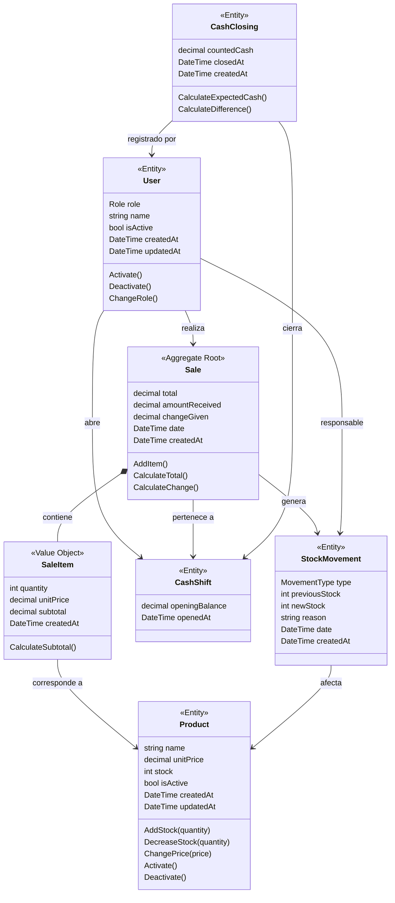
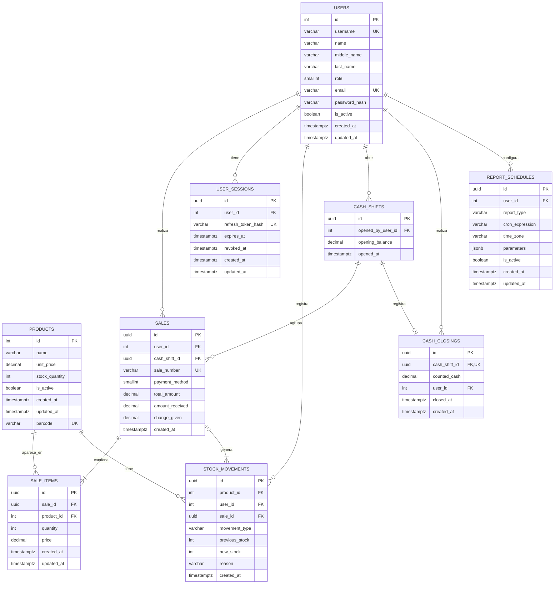
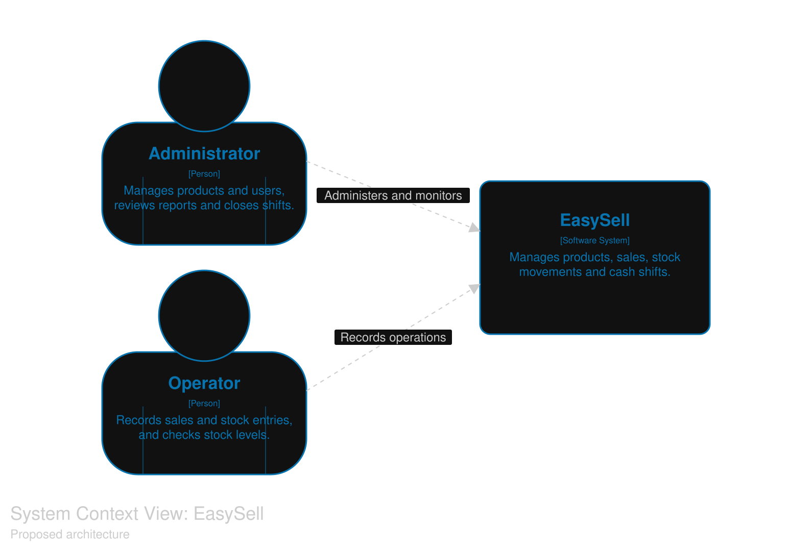
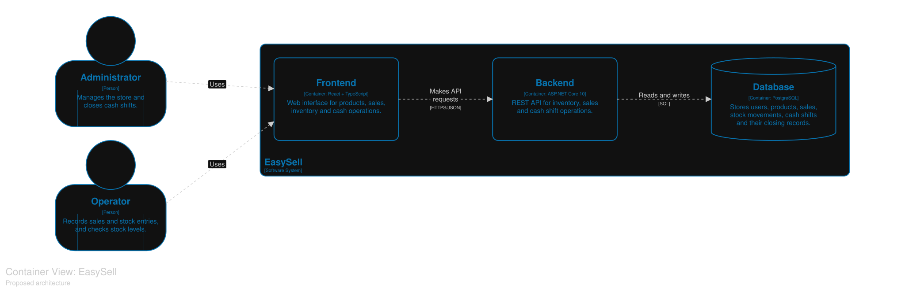
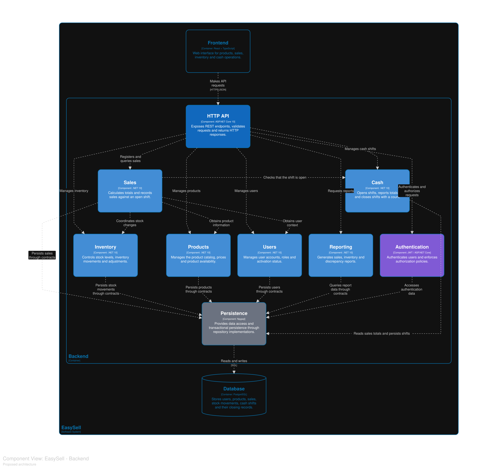

# EasySell

## 1. Descripción

### 1.1 Contexto

El negocio comercializa bebidas y otro tipo de productos y necesita
llevar un control de las existencias disponibles, las entradas de
mercancia y las ventas realizadas.

Actualmente, el control del inventario se realiza mediante registros
manuales en un cuaderno y las operaciones son realizadas por un
encargado.

### 1.2 Problema

El método actual dificulta conocer con precisión las existencias
disponibles y llevar un control confiable de las ventas realizadas. La
falta de un registro confiable provoca discrepancias entre las ventas
realizadas, existencias disponibles y la mercancia entrante.

Esto genera una mayor dependencia de la confianza en los encargados del
establecimiento y dificulta identificar oportunamente errores, pérdidas
o irregularidades en la operación.

### 1.3 Objetivo

Desarrollar un sistema que permita administrar productos, registrar
entradas y salidas de inventario, gestionar usuarios y consultar las
existencias actuales y el historial de movimientos.

### 1.4 Usuarios

- **\[Administrador\]:** Podra ver el historial de movimientos,
  gestionar los usuarios con acceso al sistema, administrar producto,
  registrar entradas y salidas de inventario y consultar las
  existencias actuales.
- **\[Usuario/Rol\]:** Podra registrar entradas y salidas de
  inventario, tambien podra consultar las existencias actuales.

---

## 2. Alcance

### 2.1 Incluido en el alcance

El sistema contemplará:

- Gestión de productos y sus existencias.
- Registro de ventas y productos vendidos.
- Actualización de existencias a partir de las ventas realizadas.
- Registro de entradas y salidas de inventario.
- Consulta del historial de movimientos de inventario.
- Consulta del historial de ventas.
- Gestión de usuarios con diferentes niveles de acceso.
- Identificación del usuario responsable de las operaciones
  realizadas.
- Consulta de información que permita detectar discrepancias entre
  ventas e inventario.
- Generación manual y programada de reportes básicos de ventas e
  inventario.
- Consulta de cortes de caja con el resumen del dinero total vendido y
  el dinero vendido por producto.
- Apertura obligatoria de un turno de caja antes de registrar ventas, con
  un fondo inicial que puede ser de $0.00, y cierre con arqueo de efectivo.

### 2.2 Fuera de alcance

### 2.3 Funcionalidades futuras

- Escaneo de códigos de barras usando la cámara del móvil desde la PWA.
  Esta funcionalidad se considera futura y deberá validarse en los
  dispositivos y navegadores compatibles.
- Agrupar refresh tokens sucesivos en una familia por sesión/dispositivo
  y detectar la reutilización de un refresh token anterior para revocar
  la sesión relacionada. En la versión inicial, la rotación invalida el
  token anterior y las solicitudes que lo presenten se rechazan, sin
  detección de replay ni revocación de una familia.

---

## 3. Requerimientos funcionales

### Autenticación

### RF-001 --- Inicio de sesión

**Descripción:**

El sistema deberá permitir que los usuarios registrados inicien sesión
utilizando sus credenciales.

**Actor:**

Usuario registrado.

**Criterios de aceptación:**

- El usuario deberá poder ingresar sus credenciales para iniciar
  sesión.
- El sistema deberá validar que las credenciales proporcionadas sean
  correctas.
- Si las credenciales son válidas, el sistema deberá permitir al
  usuario acceder a las funcionalidades correspondientes a su nivel de
  acceso.
- Si las credenciales son incorrectas, el sistema deberá rechazar el
  inicio de sesión sin indicar cuál de las credenciales es incorrecta.
- Un usuario no autenticado no deberá poder acceder a funcionalidades
  que requieran autenticación.

---

### RF-002 --- Cierre de sesión

**Descripción:**

El sistema deberá permitir que un usuario autenticado cierre su sesión.

**Actor:**

Usuario registrado.

**Criterios de aceptación:**

- El usuario autenticado deberá poder cerrar su sesión.
- Al cerrar sesión, el servidor revocará el refresh token de esa sesión,
  eliminará su cookie y el cliente descartará el access token local.
- Se aceptará que un JWT de acceso ya emitido siga siendo válido hasta
  su expiración. El cierre de sesión impedirá renovar tokens, pero no
  revocará inmediatamente los JWT de acceso. Las demás sesiones del
  usuario no se cerrarán.

---

## Gestión de usuarios

### RF-003 --- Registrar usuario

**Descripción:**

El sistema deberá permitir que el administrador registre nuevos usuarios
y les asigne uno de los roles disponibles.

**Actor:**

Usuario administrador.

**Criterios de aceptación:**

- El administrador deberá proporcionar los datos obligatorios del
  usuario.
- El sistema deberá validar los datos proporcionados.
- El sistema no deberá permitir registrar dos usuarios con el mismo
  identificador definido como único.
- El administrador deberá poder asignar un rol válido al nuevo
  usuario.
- Si los datos son válidos, el usuario deberá quedar registrado.
- El sistema deberá informar si el registro no puede realizarse.

---

### RF-004 --- Consultar usuarios

**Descripción:**

El sistema deberá permitir que el administrador consulte los usuarios
registrados.

**Actor:**

Usuario administrador.

**Criterios de aceptación:**

- El sistema deberá mostrar los usuarios registrados.
- El sistema deberá mostrar el estado y rol de cada usuario.
- El administrador deberá poder consultar la información de un usuario
  específico.

---

### RF-005 --- Editar usuario

**Descripción:**

El sistema deberá permitir que el administrador modifique la información
editable de un usuario existente.

**Actor:**

Usuario administrador.

**Criterios de aceptación:**

- El usuario que se desea modificar deberá existir.
- El sistema deberá validar los nuevos datos antes de guardar los
  cambios.
- El administrador deberá poder modificar el rol del usuario cuando
  corresponda.
- Los cambios deberán guardarse únicamente si los datos son válidos.

---

### RF-006 --- Cambiar estado de usuario

**Descripción:**

El sistema deberá permitir que el administrador active o desactive
usuarios existentes.

**Actor:**

Usuario administrador.

**Criterios de aceptación:**

- El usuario deberá existir.
- El administrador deberá poder activar un usuario desactivado.
- El administrador deberá poder desactivar un usuario activo.
- Un usuario desactivado no deberá poder iniciar sesión ni realizar
  nuevas operaciones.
- Un usuario reactivado deberá poder volver a iniciar sesión de
  acuerdo con sus credenciales y permisos asignados.
- El cambio de estado no deberá eliminar ni modificar las operaciones
  realizadas previamente por el usuario.
- El historial deberá conservar la identificación del usuario
  responsable de las operaciones anteriores.

---

## Gestión de productos

### RF-007 --- Registrar producto

**Descripción:**

El sistema deberá permitir que el administrador registre nuevos
productos.

**Actor:**

Usuario administrador.

**Criterios de aceptación:**

- El administrador deberá proporcionar los datos obligatorios del
  producto.
- El sistema deberá validar los datos proporcionados.
- El sistema deberá validar las reglas de unicidad definidas para los
  productos.
- Si los datos son válidos, el producto deberá quedar registrado.
- El sistema deberá informar si el producto no puede registrarse.

---

### RF-008 --- Editar producto

**Descripción:**

El sistema deberá permitir que el administrador modifique la información
editable de un producto existente.

**Actor:**

Usuario administrador.

**Criterios de aceptación:**

- El producto deberá existir.
- El sistema deberá validar los nuevos datos.
- Los cambios deberán guardarse únicamente si los datos son válidos.
- La modificación de los datos del producto no deberá alterar su
  historial de movimientos.

---

### RF-009 --- Consultar productos

**Descripción:**

El sistema deberá permitir que los usuarios registrados consulten los
productos existentes.

**Actor:**

Usuario registrado.

**Criterios de aceptación:**

- El sistema deberá mostrar los productos disponibles para consulta.
- El usuario deberá poder identificar las existencias actuales de cada
  producto.
- El usuario deberá poder buscar o filtrar productos según los
  criterios definidos por el sistema.

---

### RF-010 --- Consultar detalle de producto

**Descripción:**

El sistema deberá permitir que los usuarios registrados consulten la
información detallada de un producto existente.

**Actor:**

Usuario registrado.

**Criterios de aceptación:**

- El producto deberá existir.
- El sistema deberá mostrar la información registrada del producto.
- El sistema deberá mostrar las existencias actuales del producto.
- Si el producto no existe, el sistema deberá informar al usuario.

---

### RF-011 --- Cambiar estado de producto

**Descripción:**

El sistema deberá permitir que el administrador active o desactive
productos existentes.

**Actor:**

Usuario administrador.

**Criterios de aceptación:**

- El producto deberá existir.
- El administrador deberá poder activar un producto desactivado.
- El administrador deberá poder desactivar un producto activo.
- Un producto desactivado no deberá estar disponible para nuevas
  operaciones que requieran productos activos.
- Un producto reactivado deberá volver a estar disponible para las
  operaciones correspondientes.
- El cambio de estado no deberá eliminar ni modificar las ventas
  relacionadas con el producto.
- El cambio de estado no deberá eliminar ni modificar los movimientos
  de inventario relacionados con el producto.
- El producto deberá continuar disponible para consultas históricas
  independientemente de su estado.

---

## Gestión de inventario

### RF-012 --- Registrar entrada de inventario

**Descripción:**

El sistema deberá permitir que los usuarios autorizados registren
entradas de existencias para productos existentes.

**Actor:**

Usuario autorizado.

**Criterios de aceptación:**

- El producto deberá existir y encontrarse activo.
- La cantidad ingresada deberá ser mayor que cero.
- El sistema deberá aumentar las existencias del producto según la
  cantidad registrada.
- El sistema deberá registrar las existencias anteriores y posteriores
  a la entrada.
- El sistema deberá identificar al usuario responsable de la entrada.
- El sistema deberá registrar la fecha y hora de la operación.
- La entrada deberá quedar registrada en el historial de movimientos
  de inventario.

---

### RF-013 --- Ajustar existencias

**Descripción:**

El sistema deberá permitir que el administrador ajuste las existencias
registradas de un producto cuando exista una diferencia entre la
cantidad registrada y la cantidad real.

**Actor:**

Usuario administrador.

**Criterios de aceptación:**

- El producto deberá existir y encontrarse activo.
- El administrador deberá indicar la cantidad real de existencias.
- El administrador deberá proporcionar el motivo del ajuste.
- El sistema deberá calcular la diferencia entre las existencias
  registradas y las existencias indicadas.
- El sistema deberá registrar las existencias anteriores y posteriores
  al ajuste.
- El sistema deberá identificar al usuario responsable del ajuste.
- El sistema deberá registrar la fecha y hora de la operación.
- El ajuste deberá quedar registrado en el historial de movimientos de
  inventario.
- El ajuste no deberá modificar ni eliminar movimientos históricos
  anteriores.

---

### RF-014 --- Consultar existencias

**Descripción:**

El sistema deberá permitir que los usuarios registrados consulten las
existencias actuales de los productos.

**Actor:**

Usuario registrado.

**Criterios de aceptación:**

- El sistema deberá mostrar las existencias actuales de cada producto.
- El usuario deberá poder consultar las existencias de un producto
  específico.
- La información mostrada deberá corresponder con el estado actual
  registrado en el inventario.

---

### RF-015 --- Consultar historial de movimientos de inventario

**Descripción:**

El sistema deberá permitir que el administrador consulte el historial de
movimientos que hayan modificado las existencias de los productos.

**Actor:**

Usuario administrador.

**Criterios de aceptación:**

- El sistema deberá mostrar los movimientos de inventario registrados.
- Cada movimiento deberá identificar el producto afectado.
- Cada movimiento deberá indicar la cantidad modificada.
- Cada movimiento deberá indicar el tipo de operación que lo originó.
- Cada movimiento deberá identificar al usuario responsable.
- Cada movimiento deberá mostrar la fecha y hora en que ocurrió.
- Cuando el movimiento tenga una operación de origen, el sistema
  deberá permitir identificar dicha operación.
- El administrador deberá poder filtrar los movimientos según los
  criterios definidos por el sistema.

---

### RF-016 --- Consultar detalle de movimiento

**Descripción:**

El sistema deberá permitir que el administrador consulte los detalles de
un movimiento de inventario.

**Actor:**

Usuario administrador.

**Criterios de aceptación:**

- El movimiento deberá existir.
- El sistema deberá mostrar el producto afectado.
- El sistema deberá mostrar las existencias anteriores y posteriores
  al movimiento.
- El sistema deberá mostrar la cantidad modificada.
- El sistema deberá mostrar el tipo y motivo del movimiento.
- El sistema deberá identificar al usuario responsable.
- Cuando corresponda, el sistema deberá permitir consultar la
  operación que originó el movimiento.

---

## Gestión de ventas

### RF-017 --- Registrar venta

**Descripción:**

El sistema deberá permitir que los usuarios autorizados registren ventas
de uno o más productos existentes.

**Actor:**

Usuario autorizado.

**Criterios de aceptación:**

- La venta deberá contener al menos un producto.
- Solo se podrá registrar una venta en un turno de caja abierto. El sistema
  asociará cada venta al turno correspondiente (RF-024).
- Todos los productos incluidos deberán existir y encontrarse activos.
- Las cantidades vendidas deberán ser mayores que cero.
- El sistema deberá validar que existan suficientes unidades
  disponibles antes de completar la venta.
- El sistema deberá calcular el total de la venta.
- El sistema deberá registrar el método de pago; en el alcance inicial,
  solo estará disponible el pago en efectivo.
- El sistema deberá permitir registrar el importe recibido y mostrar el
  cambio que debe entregarse.
- El sistema deberá registrar al usuario responsable de la venta.
- El sistema deberá registrar la fecha y hora de la operación.
- Al completar la venta, el sistema deberá disminuir las existencias
  correspondientes.
- Cada modificación de existencias producida por la venta deberá
  quedar registrada como movimiento de inventario.
- Si la venta no puede completarse, no deberán aplicarse parcialmente
  sus modificaciones de inventario.

---

### RF-018 --- Consultar historial de ventas

**Descripción:**

El sistema deberá permitir que el administrador consulte las ventas
registradas.

**Actor:**

Usuario administrador.

**Criterios de aceptación:**

- El sistema deberá mostrar las ventas registradas.
- Cada venta deberá mostrar información básica como fecha, usuario
  responsable y total.
- El administrador deberá poder filtrar las ventas según los criterios
  definidos por el sistema.
- El administrador deberá poder acceder al detalle de una venta.

---

### RF-019 --- Consultar detalle de venta

**Descripción:**

El sistema deberá permitir que el administrador consulte la información
detallada de una venta.

**Actor:**

Usuario administrador.

**Criterios de aceptación:**

- La venta deberá existir.
- El sistema deberá mostrar los productos incluidos en la venta.
- El sistema deberá mostrar la cantidad y precio correspondiente a
  cada producto.
- El sistema deberá mostrar el total de la venta.
- El sistema deberá mostrar el importe recibido y el cambio entregado.
- El sistema deberá mostrar el usuario responsable.
- El sistema deberá mostrar la fecha y hora de la venta.
- El sistema deberá permitir identificar los movimientos de inventario
  generados por la venta.

---

## Reportes

### RF-020 --- Generar reporte

**Descripción:**

El sistema deberá permitir que el administrador genere reportes de
ventas e inventario.

**Actor:**

Usuario administrador.

**Criterios de aceptación:**

- El administrador deberá poder seleccionar el tipo de reporte.
- El administrador deberá poder definir los parámetros disponibles
  para el reporte.
- El reporte deberá generarse utilizando la información registrada en
  el sistema.
- El sistema deberá identificar el periodo o filtros utilizados para
  generar el reporte.

---

### RF-021 --- Programar reporte

**Descripción:**

El sistema deberá permitir que el administrador programe la generación
automática de reportes.

**Actor:**

Usuario administrador.

**Criterios de aceptación:**

- El administrador deberá poder seleccionar el tipo de reporte.
- El administrador deberá poder establecer la periodicidad de
  generación.
- El sistema deberá generar el reporte automáticamente según la
  programación establecida.
- El administrador deberá poder consultar las programaciones
  existentes.
- El administrador deberá poder modificar o desactivar una
  programación.

---

### RF-022 --- Consultar corte de caja

**Descripción:**

El sistema deberá permitir que el administrador consulte un corte de caja
para un periodo determinado, con el resumen del dinero total vendido y
el dinero vendido por producto.

**Actor:**

Usuario administrador.

**Criterios de aceptación:**

- El administrador deberá poder definir el periodo del corte.
- Al consultar el corte de un turno, el sistema deberá usar las ventas
  asociadas a ese turno. La consulta no cambia su estado.
- El sistema deberá mostrar el importe total de las ventas del periodo.
- El sistema deberá mostrar por producto la cantidad vendida y el importe
  correspondiente.
- El sistema deberá calcular el resumen por producto a partir de los
  detalles de las ventas incluidas en el periodo.
- El corte deberá basarse en ventas registradas y conservar los precios
  aplicados al momento de cada venta.

El corte de caja presenta el resumen de ventas del periodo. El cierre de
caja y el arqueo de efectivo se especifican en RF-023.

---

### RF-023 --- Registrar cierre de caja

**Descripción:**

El sistema deberá permitir que el administrador cierre un turno de caja
abierto, registrando el efectivo físico contado al cierre.

**Actor:**

Usuario administrador.

**Criterios de aceptación:**

- El administrador deberá seleccionar el turno abierto que se cierra. El
  sistema deberá recuperar el fondo inicial registrado en la apertura.
- El administrador deberá registrar el efectivo físico contado al cierre.
- El sistema deberá calcular el efectivo esperado como el fondo inicial
  más el total de las ventas en efectivo asociadas al turno. Si el turno
  no tuvo ventas, ese total será de $0.00.
- El sistema deberá calcular la diferencia como el efectivo contado
  menos el efectivo esperado.
- El sistema deberá indicar si la caja quedó cuadrada, con faltante o
  con sobrante, según el signo de la diferencia.
- El cierre deberá registrar al usuario que lo realizó y la fecha y hora.
- El sistema deberá marcar el turno como cerrado al confirmar el cierre.
  Un turno cerrado no admite nuevas ventas ni otro cierre.

---

### RF-024 --- Abrir turno de caja

**Descripción:**

El sistema deberá permitir abrir un turno de caja antes de registrar
ventas, capturando el efectivo físico disponible al inicio del turno.

**Actor:**

Usuario autorizado para abrir caja.

**Criterios de aceptación:**

- El monto inicial es obligatorio. Debe ser igual o mayor que $0.00.
- El usuario puede capturar explícitamente $0.00 cuando no hay efectivo
  inicial. Un campo vacío no equivale a $0.00.
- El sistema deberá rechazar montos negativos, valores no numéricos y la
  omisión del monto inicial.
- Al confirmar la apertura, el sistema deberá guardar el monto inicial,
  el usuario responsable y la fecha y hora, y dejar el turno abierto.
- Si no hay un turno abierto para la venta, el sistema deberá bloquear
  su registro e indicar que se requiere abrir un turno de caja.

---

## 4. Requerimientos no funcionales

### Seguridad

#### RNF-001 --- Protección de contraseñas

Las contraseñas de los usuarios no deberán almacenarse en texto plano y
deberán protegerse mediante un mecanismo de hashing diseñado para el
almacenamiento seguro de contraseñas.

---

#### RNF-002 --- Control de acceso

El sistema deberá impedir que los usuarios accedan a funcionalidades
para las cuales no tengan autorización, independientemente de las
restricciones implementadas en la interfaz de usuario.

---

#### RNF-003 --- Protección de comunicaciones

Las comunicaciones entre el cliente y el sistema deberán realizarse
mediante HTTPS en el entorno de producción.

---

### Integridad y consistencia

#### RNF-004 --- Atomicidad de operaciones críticas

Las operaciones que involucren múltiples modificaciones relacionadas
deberán completarse en su totalidad o no producir ningún cambio
persistente.

El registro de una venta y sus correspondientes modificaciones de
inventario deberá considerarse una operación atómica.

---

#### RNF-005 --- Consistencia ante concurrencia

El sistema deberá mantener la consistencia de las existencias cuando
múltiples operaciones intenten modificar simultáneamente el inventario
de un mismo producto.

En ningún caso una operación deberá provocar que las existencias sean
inferiores a las permitidas por las reglas del negocio.

---

### Recuperación

#### RNF-006 --- Respaldo de información

La base de datos deberá contar con un mecanismo de respaldo que permita
recuperar la información ante pérdida o corrupción de datos.

La frecuencia y retención de los respaldos se definirán de acuerdo con
las necesidades operativas del establecimiento.

---

### Rendimiento

#### RNF-007 --- Tiempo de respuesta

Las operaciones habituales del sistema deberán responder dentro de los
tiempos máximos establecidos para la operación normal.

Los valores máximos y las condiciones de carga deberán definirse y
validarse mediante pruebas de rendimiento.

---

### Calidad y mantenibilidad

#### RNF-008 --- Pruebas automatizadas

El sistema deberá contar con pruebas automatizadas para las reglas de
negocio y operaciones críticas.

Como mínimo, deberán contemplarse pruebas para:

- Registro de ventas y cálculo de sus totales.
- Apertura con $0.00, rechazo de un monto vacío o negativo, bloqueo de
  ventas sin turno abierto y cálculo del arqueo con el fondo de apertura.
- Modificación de existencias producida por una venta.
- Validación de existencias disponibles.
- Operaciones concurrentes que modifiquen el inventario.
- Atomicidad entre el registro de una venta y sus modificaciones de
  inventario.
- Control de acceso a funcionalidades restringidas.

Las pruebas deberán poder ejecutarse de forma repetible y sin depender
de modificaciones manuales al entorno.

---

### Seguridad y diagnóstico

#### RNF-009 --- Protección de información sensible

El sistema no deberá exponer contraseñas, credenciales, secretos ni
información técnica sensible mediante respuestas de error o registros de
la aplicación.

---

## 5. Reglas de negocio

### Usuarios

#### RN-001 --- Roles de usuario

Todo usuario deberá tener asignado uno de los roles definidos por el
negocio.

Los roles iniciales serán:

- Administrador (`role = 1`).
- Encargado (`role = 2`).

---

### Productos e inventario

#### RN-002 --- Identificación única de productos

Cada producto deberá contar con el identificador definido por el negocio
como único.

No podrán existir dos productos activos con el mismo identificador
cuando este deba ser único.

---

#### RN-003 --- Existencias no negativas

Las existencias disponibles de un producto no podrán ser inferiores a
cero.

---

### Ventas

#### RN-004 --- Disponibilidad para venta

La cantidad vendida de un producto no podrá superar sus existencias
disponibles.

---

#### RN-005 --- Precio histórico de venta

El precio aplicado a un producto al momento de realizar una venta deberá
conservarse como parte de dicha venta.

Los cambios posteriores en el precio del producto no deberán modificar
el importe de las ventas realizadas anteriormente.

---

#### RN-006 --- Cálculo del total de venta

El subtotal de cada producto será:

`Subtotal = cantidad × precio unitario`

El total de la venta será la suma de los subtotales de los productos
incluidos.

En el alcance inicial, todas las ventas se pagarán en efectivo. El método
de pago se representará con un código numérico pequeño para permitir
incorporar otros métodos posteriormente.

El código inicial será `payment_method = 1` para efectivo. La base de datos
restringirá el campo a este valor hasta habilitar otros métodos.

El cambio será:

`Cambio = importe recibido − total de la venta`

El importe recibido deberá ser igual o mayor que el total; el cambio no
podrá ser negativo.

---

#### RN-007 --- Ventas definitivas

Una vez registrada una venta, esta no podrá ser cancelada ni eliminada.

---

#### RN-008 --- Turno de caja obligatorio para vender

Cada venta debe pertenecer a un turno abierto al momento de confirmarla.
El monto inicial se captura en la apertura, es obligatorio y puede ser
de $0.00. El cierre usa ese monto sin volver a capturarlo.

`Efectivo esperado = monto inicial + total de ventas en efectivo del turno`

`Diferencia = efectivo contado − efectivo esperado`

Una diferencia de cero indica caja cuadrada, un valor negativo indica
faltante y un valor positivo indica sobrante.

## 6. Casos de uso

Los siguientes casos de uso documentan los flujos principales o de mayor relevancia del sistema. Las operaciones simples de consulta y mantenimiento se encuentran especificadas mediante sus requerimientos funcionales y criterios de aceptación.

---

### CU-001 — Iniciar sesión

**Actor:**
Usuario registrado.

**Objetivo:**
Acceder al sistema para utilizar las funcionalidades correspondientes a su rol.

**Requisitos relacionados:**

- RF-001 — Inicio de sesión.
- RN-001 — Roles de usuario.

**Precondiciones:**

- El usuario debe estar registrado en el sistema.
- El usuario debe encontrarse activo.

**Flujo principal:**

1. El usuario ingresa su usuario y contraseña.
2. El sistema valida las credenciales ingresadas.
3. El sistema verifica que el usuario se encuentre activo.
4. El sistema inicia la sesión.
5. El sistema permite al usuario acceder a las funcionalidades correspondientes a su rol.

**Flujos alternativos:**

**A1 — Credenciales incorrectas**

1. En el paso 2, las credenciales ingresadas no son válidas.
2. El sistema rechaza el inicio de sesión.
3. El sistema informa que las credenciales son incorrectas sin especificar cuál de ellas es inválida.
4. El usuario permanece sin autenticar.

**A2 — Usuario desactivado**

1. En el paso 3, el usuario se encuentra desactivado.
2. El sistema rechaza el inicio de sesión.
3. El usuario permanece sin autenticar.

**Postcondiciones:**

- El usuario queda autenticado.
- El usuario puede acceder a las funcionalidades permitidas por su rol.

---

### CU-002 — Registrar entrada de inventario

**Actor:**
Usuario autorizado.

**Objetivo:**
Registrar la entrada de nuevas existencias de un producto.

**Requisitos relacionados:**

- RF-012 — Registrar entrada de inventario.
- RN-003 — Existencias no negativas.

**Precondiciones:**

- El usuario debe estar autenticado.
- El usuario debe contar con autorización para registrar entradas.
- El producto debe existir y encontrarse activo.

**Flujo principal:**

1. El usuario inicia el registro de una entrada de inventario.
2. El usuario selecciona el producto.
3. El sistema muestra la información y las existencias actuales del producto.
4. El usuario indica la cantidad de unidades recibidas.
5. El usuario confirma la entrada.
6. El sistema valida los datos proporcionados.
7. El sistema aumenta las existencias del producto.
8. El sistema registra las existencias anteriores y posteriores.
9. El sistema registra el movimiento de inventario con el usuario responsable y la fecha y hora de la operación.
10. El sistema informa que la entrada fue registrada correctamente.

**Flujos alternativos:**

**A1 — Cantidad inválida**

1. En el paso 6, la cantidad indicada es menor o igual a cero.
2. El sistema informa que la cantidad no es válida.
3. La entrada no se registra.

**A2 — Producto no disponible**

1. El producto seleccionado no existe o se encuentra desactivado.
2. El sistema impide registrar la entrada.
3. La entrada no modifica las existencias.

**Postcondiciones:**

- Las existencias del producto quedan incrementadas.
- La entrada queda registrada en el historial de movimientos.
- El movimiento queda asociado al usuario responsable.

---

### CU-003 — Ajustar existencias

**Actor:**
Administrador.

**Objetivo:**
Corregir las existencias registradas cuando exista una diferencia con las existencias reales.

**Requisitos relacionados:**

- RF-013 — Ajustar existencias.
- RN-003 — Existencias no negativas.

**Precondiciones:**

- El administrador debe estar autenticado.
- El producto debe existir y encontrarse activo.

**Flujo principal:**

1. El administrador selecciona el producto que desea ajustar.
2. El sistema muestra las existencias actualmente registradas.
3. El administrador indica la cantidad real encontrada.
4. El administrador proporciona el motivo del ajuste.
5. El administrador confirma el ajuste.
6. El sistema valida los datos proporcionados.
7. El sistema calcula la diferencia entre las existencias registradas y las existencias reales.
8. El sistema actualiza las existencias.
9. El sistema registra las existencias anteriores y posteriores al ajuste.
10. El sistema registra el movimiento, motivo, usuario responsable y fecha y hora.
11. El sistema informa que el ajuste fue realizado correctamente.

**Flujos alternativos:**

**A1 — Cantidad no permitida**

1. En el paso 6, la cantidad indicada incumple las reglas de inventario.
2. El sistema rechaza el ajuste.
3. Las existencias permanecen sin cambios.

**A2 — Motivo no proporcionado**

1. En el paso 6, no se proporcionó un motivo.
2. El sistema solicita al administrador indicar el motivo.
3. El ajuste no se realiza hasta proporcionar la información requerida.

**Postcondiciones:**

- Las existencias reflejan la cantidad indicada en el ajuste.
- El ajuste queda registrado en el historial.
- Los movimientos históricos anteriores permanecen sin modificaciones.

---

### CU-004 — Registrar venta

**Actor:**
Usuario autorizado.

**Objetivo:**
Registrar la venta de uno o más productos y actualizar las existencias correspondientes.

**Requisitos relacionados:**

- RF-017 — Registrar venta.
- RF-024 — Abrir turno de caja.
- RN-003 — Existencias no negativas.
- RN-004 — Disponibilidad para venta.
- RN-005 — Precio histórico de venta.
- RN-006 — Cálculo del total de venta.
- RN-007 — Ventas definitivas.
- RN-008 — Turno de caja obligatorio para vender.

**Precondiciones:**

- El usuario debe estar autenticado.
- El usuario debe contar con autorización para registrar ventas.
- Debe haber un turno de caja abierto para la venta.

**Flujo principal:**

1. El usuario inicia el registro de una venta.
2. El usuario selecciona un producto.
3. El sistema muestra la información necesaria del producto.
4. El usuario indica la cantidad que desea vender.
5. El sistema agrega el producto a la venta.
6. El usuario repite el proceso para los demás productos que desea incluir.
7. El sistema calcula los subtotales y el total de la venta.
8. El usuario indica el importe recibido.
9. El sistema valida que el importe recibido sea igual o mayor que el total y calcula el cambio.
10. El usuario confirma la venta.
11. El sistema valida que el turno siga abierto, que los productos se encuentren activos y que existan suficientes unidades disponibles.
12. El sistema registra la venta y la vincula al turno. Conserva los precios aplicados, el importe recibido y el cambio.
13. El sistema disminuye las existencias correspondientes.
14. El sistema registra los movimientos de inventario generados por la venta.
15. El sistema asocia la venta y los movimientos con el usuario responsable y la fecha y hora.
16. El sistema informa que la venta fue registrada correctamente y muestra el cambio que debe entregarse.

**Flujos alternativos:**

**A1 — Existencias insuficientes**

1. En el paso 11, uno o más productos no cuentan con existencias suficientes.
2. El sistema informa que la venta no puede completarse.
3. La venta no se registra.
4. No se aplican modificaciones parciales al inventario.

**A2 — Producto no disponible**

1. En el paso 11, uno de los productos se encuentra desactivado o ya no está disponible.
2. El sistema informa que el producto no puede venderse.
3. La venta no se completa hasta corregir su contenido.

**A3 — Datos de venta inválidos**

1. El sistema detecta una cantidad inválida u otro dato requerido incorrecto.
2. El sistema informa el problema.
3. La venta no se registra hasta corregir los datos.

**A4 — No hay turno abierto**

1. El sistema detecta que no existe un turno abierto para la venta o que
   el turno se cerró antes de confirmarla.
2. El sistema bloquea el registro e indica que se necesita un turno abierto.
3. La venta no se registra y las existencias no cambian.

**Postcondiciones:**

- La venta queda registrada de forma definitiva.
- Los precios aplicados quedan conservados como parte de la venta.
- El importe recibido y el cambio quedan conservados como parte de la venta.
- Las existencias quedan actualizadas.
- Los movimientos de inventario correspondientes quedan registrados.
- La venta queda asociada al usuario responsable y al turno de caja.

---

### CU-005 — Programar reporte

**Actor:**
Administrador.

**Objetivo:**
Configurar la generación automática y periódica de un reporte.

**Requisitos relacionados:**

- RF-021 — Programar reporte.

**Precondiciones:**

- El administrador debe estar autenticado.
- El administrador debe contar con autorización para administrar reportes.

**Flujo principal:**

1. El administrador inicia la creación de una programación de reporte.
2. El administrador selecciona el tipo de reporte.
3. El administrador establece los parámetros disponibles.
4. El administrador establece la periodicidad de generación.
5. El administrador confirma la programación.
6. El sistema valida la configuración proporcionada.
7. El sistema registra la programación.
8. Al cumplirse la periodicidad establecida, el sistema genera automáticamente el reporte correspondiente.

**Flujos alternativos:**

**A1 — Configuración inválida**

1. En el paso 6, el sistema detecta que la configuración no es válida o está incompleta.
2. El sistema informa los datos que deben corregirse.
3. La programación no se registra hasta que la información sea válida.

**A2 — Modificar programación**

1. El administrador selecciona una programación existente.
2. El administrador modifica su configuración.
3. El sistema valida los cambios.
4. El sistema actualiza la programación.

**A3 — Desactivar programación**

1. El administrador selecciona una programación existente.
2. El administrador solicita su desactivación.
3. El sistema desactiva la programación.
4. El sistema deja de generar automáticamente el reporte según dicha programación.

**Postcondiciones:**

- La programación queda registrada y activa.
- El sistema generará el reporte según la configuración establecida mientras la programación permanezca activa.

---

### CU-006 — Registrar cierre de caja

**Actor:**
Administrador.

**Objetivo:**
Registrar el efectivo contado al cierre de un turno y conocer si la
caja quedó cuadrada, con faltante o con sobrante.

**Requisitos relacionados:**

- RF-022 — Consultar corte de caja.
- RF-023 — Registrar cierre de caja.
- RF-024 — Abrir turno de caja.
- RN-008 — Turno de caja obligatorio para vender.

**Precondiciones:**

- El administrador debe estar autenticado y autorizado para cerrar caja.
- Debe existir un turno abierto. Puede cerrarse sin ventas registradas.

**Flujo principal:**

1. El administrador selecciona el turno abierto que va a cerrar.
2. El sistema muestra el monto inicial registrado al abrir el turno y el total de sus ventas en efectivo.
3. El administrador cuenta el efectivo físico disponible.
4. El administrador registra el efectivo contado.
5. El sistema calcula el efectivo esperado como monto inicial más el total vendido en efectivo en ese turno.
6. El sistema calcula la diferencia entre el efectivo contado y el esperado.
7. El sistema muestra si la caja quedó cuadrada, con faltante o con sobrante.
8. El administrador confirma el cierre.
9. El sistema registra el cierre con el usuario responsable y la fecha y hora. El turno pasa a cerrado.

**Flujo alternativo — Turno ya cerrado:**

1. El sistema detecta que ya existe un cierre para el turno.
2. El sistema informa que el turno ya fue cerrado y no registra otro cierre.

**Postcondiciones:**

- El cierre queda asociado al turno y al usuario que lo realizó.
- El efectivo esperado, la diferencia y el resultado se derivan del
  monto inicial, el efectivo contado y las ventas del turno.

---

### CU-007 — Abrir turno de caja

**Actor:** Usuario autenticado con autorización para abrir caja.

**Requisitos relacionados:** RF-024 y RN-008.

**Flujo principal:**

1. El usuario selecciona **Abrir turno** en Caja.
2. El sistema solicita el monto inicial de efectivo.
3. El usuario captura el monto, incluido $0.00 si inicia sin efectivo,
   y confirma la apertura.
4. El sistema valida el importe y registra el turno abierto con el
   monto inicial, el usuario y la fecha y hora de apertura.

**Flujo alternativo — Monto inicial inválido:**

Si el campo está vacío, contiene un valor no numérico o el monto es
negativo, el sistema solicita corregirlo y no abre el turno.

---

## 7. Modelo de dominio

### 7.1 Entidades principales

#### User

**Responsabilidad:** Representa a un encargado de la tienda, ya sea administrador o trabajador.

**Propiedades principales:**

- Rol
- Nombre
- Está activo
- Fecha de creación (`created_at`).
- Fecha de última modificación (`updated_at`).

**Reglas:**

- Todo usuario debe tener asignado un rol válido.
- Un usuario desactivado no puede realizar nuevas operaciones en el sistema.

**Comportamientos:**

- Activar.
- Desactivar.
- Cambiar rol.

#### Product

**Responsabilidad:** Representa un producto que la tienda ofrece para su venta y del cual se controlan sus existencias.

**Propiedades principales:**

- Nombre
- Precio por unidad
- Existencias
- Está activo
- Fecha de creación (`created_at`).
- Fecha de última modificación (`updated_at`).

**Reglas:**

- Las existencias no pueden ser inferiores a cero.
- La cantidad utilizada para incrementar o disminuir existencias debe ser mayor a cero.

**Comportamientos:**

- Incrementar existencias.
- Disminuir existencias.
- Cambiar precio.
- Activar.
- Desactivar.

#### Sale

**Tipo:** Entidad

**Responsabilidad:** Representa una venta realizada en la tienda y agrupa los productos, cantidades y precios aplicados en dicha operación.

**Propiedades principales:**

- Productos vendidos (`SaleItem`).
- Turno de caja asociado (`CashShift`).
- Método de pago (inicialmente, efectivo).
- Total.
- Importe recibido.
- Cambio entregado.
- Usuario responsable.
- Fecha de realización.
- Fecha de creación (`created_at`).

**Reglas:**

- Una venta debe contener al menos un producto.
- El turno asociado debe estar abierto cuando se confirma la venta.
- El método de pago debe ser uno de los métodos habilitados; inicialmente,
  solo se permite efectivo.
- El total de la venta corresponde a la suma de los subtotales de sus productos.
- El importe recibido debe ser igual o mayor que el total de la venta.
- El cambio corresponde al importe recibido menos el total de la venta.
- El precio aplicado a cada producto debe conservarse como parte de la venta.
- Una vez registrada, una venta no puede ser cancelada ni eliminada.

**Comportamientos:**

- Agregar producto a la venta.
- Calcular total.
- Calcular cambio.

#### CashShift

**Tipo:** Entidad

**Responsabilidad:** Representa la apertura del turno de caja al que se
asocian las ventas.

**Propiedades principales:** Monto inicial, usuario que abrió el turno
y fecha y hora de apertura.

**Reglas:** El monto inicial es obligatorio y no puede ser negativo.
El turno está abierto hasta que se registra su cierre.

#### CashClosing

**Tipo:** Entidad

**Responsabilidad:** Representa el arqueo y cierre de un turno de caja.

**Propiedades principales:**

- Turno de caja cerrado (`CashShift`).
- Efectivo contado físicamente.
- Usuario responsable del cierre.
- Fecha y hora del cierre.
- Fecha de creación (`created_at`).

**Valores derivados:**

- Efectivo esperado: monto inicial más ventas en efectivo del turno.
- Diferencia: efectivo contado menos efectivo esperado.
- Resultado: caja cuadrada, faltante o sobrante, derivado de la diferencia.

**Reglas:**

- Solo puede existir un cierre por turno.
- Los importes de efectivo no pueden ser negativos.

#### SaleItem

**Tipo:** Value Object

**Responsabilidad:** Representa un producto incluido en una venta junto con la cantidad vendida y el precio aplicado en ese momento.

**Propiedades principales:**

- Producto.
- Cantidad.
- Precio unitario.
- Subtotal.
- Fecha de creación (`created_at`), como parte persistida del detalle.

**Reglas:**

- La cantidad debe ser mayor a cero.
- El precio unitario corresponde al precio aplicado al momento de realizar la venta.
- El subtotal corresponde a la cantidad multiplicada por el precio unitario.

**Comportamientos:**

- Calcular subtotal.

#### StockMovement

**Tipo:** Entidad

**Responsabilidad:** Representa un cambio ocurrido en las existencias de un producto y conserva la información necesaria para conocer su origen y mantener la trazabilidad del inventario.

**Propiedades principales:**

- Producto.
- Tipo de movimiento.
- Cantidad.
- Existencias anteriores.
- Existencias posteriores.
- Usuario responsable.
- Fecha de realización.
- Fecha de creación (`created_at`).
- Motivo, cuando corresponda.

**Reglas:**

- Un movimiento debe representar un cambio válido en las existencias.
- Las existencias posteriores no pueden ser inferiores a cero.
- Un movimiento registrado no debe modificarse ni eliminarse.
- Los movimientos originados por ajustes deben conservar el motivo del ajuste.

**Comportamientos:**

- No se identifican comportamientos que modifiquen el movimiento una vez creado, ya que representa un registro histórico.

---

### 7.2 Relaciones



---

## 8. Modelo de datos

### 8.1 Tablas principales

| Tabla                | Descripción                                                                                                                                              |
| -------------------- | --------------------------------------------------------------------------------------------------------------------------------------------------------- |
| `users`            | Almacena la identidad, credenciales, rol y estado activo de los usuarios. |
| `user_sessions`    | Almacena las sesiones de cada usuario, con el hash del refresh token vigente, su vencimiento y revocación. Permite sesiones simultáneas independientes. |
| `products`         | Almacena los productos registrados, su precio actual, existencias y estado.                                                                               |
| `sales`            | Almacena las ventas realizadas, incluyendo el folio, método de pago, total, importe recibido, cambio, fecha y usuario responsable. El diseño prevé vincular cada nueva venta a su turno de caja. |
| `sale_items`       | Almacena las líneas de cada venta con un identificador UUID, el producto, la cantidad y el precio unitario aplicado en el campo `price`. |
| `stock_movements`  | Almacena el historial de cambios en las existencias de los productos, incluyendo entradas, salidas por venta y ajustes de inventario.                     |
| `cash_shifts`      | Almacena el monto inicial, el usuario responsable y la fecha y hora de apertura. |
| `cash_closings`    | Almacena el turno cerrado, efectivo contado, usuario responsable y fecha del cierre. El efectivo esperado y la diferencia se derivan. |
| `report_schedules` | Almacena la configuración de reportes automáticos: tipo, periodicidad, zona horaria, parámetros, usuario responsable y estado activo.                  |

### 8.2 Diagrama ER

`users`, `products`, `sales` y `sale_items` reflejan las migraciones existentes,
excepto `sales.cash_shift_id`, que forma parte del diseño previsto. La existencia
de una migración no implica que ya esté aplicada en cada ambiente. Las demás
tablas todavía requieren sus migraciones. Los campos que referencian usuarios o
productos usarán `int`, compatible con sus claves `serial`.

Cada línea de `sale_items` tiene una clave primaria `id` de tipo UUID y
referencias a `sales` y `products`. La migración exige `quantity > 0` y
`price >= 0`; `price` conserva el precio unitario aplicado en la venta. El
subtotal de la línea puede calcularse como `quantity * price` y no se almacena
en esta tabla. La migración permite varias líneas con el mismo producto dentro
de una venta; no define una restricción única sobre `sale_id` y `product_id`.
Las fechas `created_at` y `updated_at` se inicializan al insertar, pero
`updated_at` no se actualiza automáticamente. El UUID identifica la fila en
persistencia y no obliga a cambiar por sí solo el tratamiento de `SaleItem`
como objeto de valor en el modelo de dominio.



### 8.3 Consideraciones

#### Turnos de caja

En el esquema previsto, el monto inicial será obligatorio y tendrá una
restricción que permita cero y rechace montos negativos. Toda venta nueva
requerirá un turno abierto. La fecha de apertura y la del cierre delimitan
el turno, y las ventas se identifican por su vínculo con este.

#### Sesiones de usuario

Cada inicio de sesión creará un registro independiente en `user_sessions`,
permitiendo que un usuario mantenga sesiones simultáneas en distintos dispositivos
o navegadores. `user_id` será obligatorio y no tendrá una restricción de unicidad.

`refresh_token_hash` almacenará únicamente el hash del token vigente, nunca su
valor original. La renovación comprobará que la sesión no esté revocada ni vencida
y reemplazará el hash de forma atómica, condicionado a que el hash anterior aún
coincida. Solo una renovación concurrente con el mismo token podrá tener éxito.
No se conservará una familia ni un historial de tokens en el alcance inicial.

`expires_at` se fijará a las 12 horas del inicio de sesión y no se extenderá al
rotar el token. `revoked_at` será nulo mientras no se haya revocado la sesión;
al cerrar sesión se establecerá en el registro correspondiente, invalidando su
refresh token sin afectar las sesiones de los otros dispositivos. Este registro
no invalida por sí solo un JWT de acceso ya emitido; se acepta su vigencia hasta
la expiración, sin consultar la revocación de sesión para invalidarlo antes.

#### Configuración de reportes automáticos

Cada registro de `report_schedules` representará una programación de RF-021.
`report_type` identificará el tipo de reporte y `parameters` contendrá sus
filtros y opciones. La periodicidad se expresará mediante `cron_expression`,
interpretada en la zona horaria IANA indicada en `time_zone`. El sistema validará
el tipo de reporte, sus parámetros, la expresión y la zona horaria antes de
guardar la configuración.

`user_id` identificará al usuario responsable de la configuración. Solo las
programaciones con `is_active = true` podrán ejecutarse automáticamente.
Esta tabla guardará la configuración; no representa el historial de ejecuciones
ni el contenido de los reportes generados.

#### Marcas de tiempo y estado

Las entidades persistentes tendrán `created_at` para registrar cuándo se
creó el registro. Las entidades que puedan editarse tendrán también
`updated_at`, que se actualizará en cada modificación. Ambas marcas se
almacenarán en UTC. Las fechas propias de una operación, como la fecha de
la venta (`created_at`) o el cierre (`closed_at`), describen cuándo ocurrió
el hecho de negocio y no se sustituirán por `updated_at`.

Las fechas de creación y modificación serán obligatorias. Los triggers de
`users` y `products` asignarán `CURRENT_TIMESTAMP` a `updated_at` antes de
cada actualización.

En PostgreSQL, estos campos usarán `timestamptz`. La API tratará los valores
como UTC y los devolverá con zona explícita; al mostrar o interpretar un
periodo local, convertirá la hora local a UTC en la aplicación.

`is_active` se utilizará solo en entidades que puedan desactivarse sin
borrar su historial, como usuarios, productos y programaciones de reportes.
Ventas, detalles de venta, movimientos de inventario y cierres de caja son
registros históricos y no tendrán `is_active` ni `updated_at`.

#### Estrategia de eliminación

Los registros históricos —ventas, detalles de venta, movimientos de
inventario y cierres de caja— no podrán eliminarse ni desactivarse. Los
usuarios, productos y programaciones podrán desactivarse, pero no eliminarse
si tienen historial relacionado.

#### Concurrencia

Las operaciones que modifican las existencias deben evitar que operaciones concurrentes produzcan existencias negativas o inconsistentes.

#### Índices

Los índices serán definidos de acuerdo con el performance de consultas y filtros utilizados por el sistema.

---

## 9. Arquitectura

### 9.1 Arquitectura seleccionada

EasySell propone un **backend monolítico organizado con Clean Architecture**.
Una sola API simplifica el despliegue y la operación del backend. Los casos
de uso de Caja, Ventas e Inventario comparten PostgreSQL, lo que permite
validar el turno y guardar la venta, el descuento de existencias y sus
movimientos en una sola transacción (RF-017, RNF-004 y RNF-005).

Clean Architecture mantiene las reglas del negocio separadas de HTTP y
Npgsql. Así pueden probarse, por ejemplo, el cálculo del cambio y las
validaciones de cantidades sin iniciar la API ni conectarse a PostgreSQL.
El costo es mantener límites claros entre proyectos, definir contratos y
mapear datos entre las capas cuando sus modelos difieren.

### 9.2 Componentes principales

| Componente               | Responsabilidad                                                                                                                                          |
| ------------------------ | -------------------------------------------------------------------------------------------------------------------------------------------------------- |
| **API**            | Exponer endpoints HTTP, recibir solicitudes, validar su formato y devolver respuestas.                                                                   |
| **Application**    | Implementar los casos de uso, coordinar las operaciones del dominio y definir los contratos necesarios para acceder a servicios externos o persistencia. |
| **Domain**         | Contener las entidades, reglas de negocio, comportamientos e invariantes del sistema.                                                                    |
| **Infrastructure** | Implementar los contratos de persistencia con Npgsql y PostgreSQL, usando operaciones parametrizadas. |

Dentro de la API, estos componentes colaborarán en las operaciones de caja y venta.

| Componente funcional | Responsabilidad e interacción |
| --- | --- |
| **Caja** | Abre turnos con un monto inicial, consulta el corte y registra el cierre con el efectivo contado. Determina si el turno admite ventas y consulta los importes registrados para calcular el efectivo esperado al cerrar. |
| **Ventas** | Comprueba con Caja que el turno esté abierto, calcula el total y el cambio, y coordina con Inventario el descuento de existencias. Registra la venta y su detalle vinculados al turno. |
| **Inventario** | Gestiona entradas y ajustes. Durante una venta, aplica el descuento si hay stock suficiente y registra los movimientos vinculados a la venta. |

La validación del turno, el descuento de existencias y el registro de la
venta y sus movimientos comparten la misma transacción. Si alguna parte falla,
la operación completa se revierte. La coordinación entre venta y cierre se
describe en [Concurrencia y consistencia](#12-concurrencia-y-consistencia).

### 9.3 Dependencias y patrones

* Domain no dependerá de las demás capas.
* Application dependerá de Domain.
* Infrastructure dependerá de Application y Domain.
* API dependerá de Application y utilizará Infrastructure para configurar las implementaciones mediante inyección de dependencias.

- **Repository.** `Application` define los contratos con las operaciones de
  persistencia que necesitan los casos de uso. `Infrastructure` implementa
  esos contratos mediante Npgsql, envía parámetros a PostgreSQL y mapea los
  resultados. El código de aplicación trabaja con esos contratos y puede usar
  implementaciones de prueba.
- **Inyección de dependencias.** La API registra las implementaciones de
  `Infrastructure` al iniciar. El contenedor de dependencias las suministra
  a los casos de uso que requieren esos contratos.
- **Result.** `Application` devuelve un resultado de éxito o un fallo esperado
  con código y mensaje, por ejemplo cuando el turno está cerrado o el stock es
  insuficiente. La API traduce el resultado a HTTP siguiendo la sección
  [Manejo de errores](#13-manejo-de-errores).

### 9.4 Decisiones Arquitectonicas

Las decisiones que requieran justificar alternativas y consecuencias se documentarán mediante Architecture Decision Records (ADR).

### 9.5 Diagrama de arquitectura

Los diagramas C4 representan la arquitectura propuesta. El prototipo del
frontend guarda los datos en `localStorage` y la integración con la API y
PostgreSQL está pendiente. Cada vista cuenta con una leyenda en
[`docs/architecture/`](architecture/).

#### Contexto del sistema



[Abrir diagrama de contexto](architecture/SystemContext-dark.svg) · [Abrir leyenda](architecture/SystemContext-dark-key.svg)

#### Contenedores



[Abrir diagrama de contenedores](architecture/Containers-dark.svg) · [Abrir leyenda](architecture/Containers-dark-key.svg)

#### Componentes del backend



[Abrir diagrama de componentes](architecture/BackendComponents-dark.svg) · [Abrir leyenda](architecture/BackendComponents-dark-key.svg)

---

## 10. Stack tecnológico

| Área                       | Tecnología                                                        | Versión / estado                                                                |
| --------------------------- | ------------------------------------------------------------------ | -------------------------------------------------------------------------------- |
| Backend                     | .NET / ASP.NET Core Web API                                        | .NET 10 (`net10.0`)                                                            |
| Arquitectura                | Separación en proyectos API, Application, Domain e Infrastructure | Implementada como estructura del backend                                         |
| Acceso a datos              | Npgsql                                                             | 10.0.3; integración en desarrollo                                               |
| Base de datos               | PostgreSQL                                                         | Configurada localmente; versión del servidor por definir                        |
| Migraciones SQL             | Flyway                                                             | Configuración y scripts del proyecto; versión de CLI según instalación local |
| Frontend                    | React / React DOM                                                  | 19.3.1                                                                           |
| Lenguaje frontend           | TypeScript                                                         | 6.0.3                                                                            |
| Gestor de paquetes frontend | pnpm                                                               | Lockfile v9                                                                      |
| Runtime frontend            | Node.js                                                            | Versión por definir                                                             |
| Desarrollo y build frontend | Vite                                                               | 8.3.8 (lockfile)                                                                 |
| Componentes visuales        | Ant Design                                                         | 6.7.0                                                                            |
| API                         | OpenAPI                                                            | `Microsoft.AspNetCore.OpenApi` 10.0.12                                         |
| Pruebas frontend            | Node.js test runner                                                | Script configurado; cobertura pendiente                                          |
| Pruebas backend             | —                                                                 | Proyecto de pruebas pendiente                                                    |

### 10.1 Justificación de las tecnologías

| Tecnología | Justificación para EasySell | Costo o compromiso |
| --- | --- | --- |
| **ASP.NET Core sobre .NET 10** | Proporciona la base para exponer los casos de uso mediante controladores HTTP, aplicar políticas de autorización, configurar la inyección de dependencias y describir la API con OpenAPI. | La capa API debe mantener la configuración del pipeline HTTP y mapear las respuestas de los casos de uso a su contrato público. |
| **React, TypeScript y Ant Design** | React y Ant Design permiten reutilizar tablas, formularios y modales entre productos, ventas y caja. TypeScript ayuda a detectar inconsistencias en los datos que intercambian los componentes. | El frontend debe organizar el estado, manejar errores y sincronizar las vistas con la API cuando se integre. |
| **PostgreSQL y Npgsql directo** | PostgreSQL permite aplicar restricciones de integridad y agrupar las escrituras de la venta en una transacción. Npgsql permite ejecutar SQL y funciones PostgreSQL con parámetros y controlar de forma explícita los límites de la transacción. | El equipo mantiene el SQL, el mapeo de resultados y la coordinación de transacciones que abarcan varias llamadas a la base de datos. |
| **Flyway** | Versiona los cambios de esquema y automatiza la aplicación de migraciones SQL en la base temporal de CI y en el despliegue descrito en la [sección 16](#16-cicd). | Los cambios sobre un esquema ya desplegado se incorporan mediante nuevas migraciones y deben considerar los datos existentes. |

---

## 11. Seguridad

### Autenticación

La API utilizará un JWT de acceso de corta duración y un refresh token de larga duración almacenado en una cookie `HttpOnly`, `Secure` y `SameSite=Strict`. El token de acceso se enviará en las solicitudes a endpoints protegidos. Los secretos de firma y demás credenciales se guardarán fuera del código fuente y de los archivos versionados. La política de cookie se registra en [ADR-007](adr/ADR-007-samesite-strict.md).

#### Refresh tokens

El refresh token será opaco, aleatorio y validado mediante comparación con un hash persistido en el servidor. Cada sesión tendrá una duración absoluta de 12 horas desde el inicio de sesión; la rotación no extenderá ese límite y en la versión inicial no habrá expiración por inactividad. La cookie tendrá una expiración alineada con el límite de la sesión. El refresh token se rotará en cada renovación exitosa del access token y el anterior se invalidará. La operación será atómica para que solo una de varias renovaciones simultáneas con el mismo token tenga éxito.

El cliente agrupará las renovaciones concurrentes dentro de cada pestaña; no habrá coordinación entre pestañas. Si dos pestañas renuevan simultáneamente, una solicitud puede rechazarse; ese rechazo no borrará la cookie ni cerrará la sesión. Después de que el navegador reciba la cookie nueva de la renovación exitosa, la pestaña perdedora podrá reintentar la renovación; si la solicitud protegida que la originó también falló, deberá reintentarse. Si el servidor completa una rotación pero se pierde la respuesta con la cookie nueva, el token anterior será rechazado y el usuario tendrá que iniciar sesión nuevamente. La recuperación de esa respuesta perdida queda fuera del alcance inicial.

La agrupación de tokens en familias y la detección/revocación coordinada por reutilización de un token antiguo quedan para una funcionalidad futura. El inicio de sesión crea una sesión; el cierre de sesión revoca el refresh token vigente de esa sesión.

### Autorización

Los endpoints exigirán autenticación y aplicarán políticas/roles usando claims del JWT. El token incluirá el identificador estable del usuario (claim `sub`) y su rol. El backend validará firma, emisor, audiencia y expiración. Cada operación comprobará que el usuario siga activo y que los permisos continúen vigentes; los claims de un JWT ya emitido no cambian al modificar el rol. El cierre de sesión revocará la renovación, pero se aceptará que el JWT de acceso siga siendo válido hasta expirar.

### Validación de entradas e integridad

Se validarán los datos en la API, en los casos de uso de Application y mediante invariantes del dominio. La validación comprueba formato, rangos y reglas de negocio. La sanitización se aplicará según el contexto de salida o almacenamiento; no se debe transformar indiscriminadamente la entrada, y las consultas a datos usarán parámetros mediante Npgsql. La base de datos impondrá restricciones `NOT NULL`, `UNIQUE`, `CHECK` y claves foráneas donde correspondan, como última barrera contra datos inválidos o corruptos.

### CORS

En producción, React y la API se expondrán bajo el mismo origen mediante enrutamiento por ruta (por ejemplo, `/` para React y `/api/*` para la API). Por ello, el navegador no necesitará CORS para las llamadas de la aplicación y no se habilitará CORS en producción. En desarrollo local, si frontend y API usan puertos distintos, CORS permitirá solo el origen local exacto del frontend y únicamente los métodos y encabezados necesarios; se permitirán cookies solo para el flujo que las use. No se permitirá cualquier origen (`*`) junto con cookies. Véanse [ADR-005](adr/ADR-005-despliegue-bajo-un-origen.md), [ADR-006](adr/ADR-006-cors-y-origen-unico.md) y [ADR-008](adr/ADR-008-proteccion-csrf-refresh.md).

### Rate limiting

Se combinarán políticas por tipo de endpoint:

- **Endpoints públicos de autenticación (inicio de sesión):** ventana deslizante particionada por IP para limitar intentos de forma continua y evitar ráfagas en el borde entre ventanas fijas. Cuando exista una identidad de cuenta normalizada, se podrá añadir un límite complementario por cuenta, cuidando no permitir que terceros bloqueen cuentas fácilmente.
- **Renovación de tokens:** política propia y estricta, también con ventana deslizante por IP y por el refresh token presentado. La renovación no se agrupa con el límite general porque usa una credencial de larga duración y puede emitir nuevos tokens.
- **Endpoints protegidos de uso general:** ventana deslizante con un límite amplio por usuario autenticado, como control contra automatización, bucles de reintento o abuso de una cuenta.

Se usará ventana deslizante en todas las categorías de endpoints, con límites y particiones distintos según el riesgo: más estrictos para login y renovación, y amplios para endpoints protegidos generales. Los límites concretos se determinarán según el volumen legítimo esperado y se ajustarán con métricas. Las respuestas rechazadas usarán `429 Too Many Requests` y `Retry-After` cuando el algoritmo permita calcularlo. Si la API se despliega detrás de un proxy, solo se confiará en la IP indicada por encabezados reenviados cuando la solicitud provenga de un proxy configurado como confiable. Hasta entonces, se usará la IP de la conexión directa.

### Auditoría

Se registrarán eventos relevantes para reconstruir quién hizo qué y cuándo: inicios de sesión y fallos, cambios de usuarios/roles, altas y cambios de productos, ventas y movimientos de inventario. No se registrarán eventos de renovación de tokens ni de cierre de sesión. Cada evento auditado debe incluir fecha UTC, actor (ID del usuario o indicación de anónimo), acción, entidad afectada e identificador de correlación; para cambios críticos también puede conservar valores anteriores y posteriores, evitando secretos, contraseñas, JWT y refresh tokens. Los registros deben tener acceso restringido y retención definida. La auditoría de negocio debe persistirse de forma consistente con la operación crítica; los logs operativos sirven para diagnóstico y no sustituyen ese historial.

Las medidas descritas en esta sección son el diseño acordado; varias aún requieren implementación y configuración por ambiente.

---

## 12. Concurrencia y consistencia

### Recursos críticos

- Existencias de cada producto, modificadas por entradas de inventario,
  ajustes y ventas (RF-012, RF-013 y RF-017).
- Turno de caja, cuyo cierre debe registrarse una sola vez y coordinarse
  con el registro de sus ventas (RF-017, RF-023 y RF-024).
- Identificadores definidos como únicos para usuarios y productos durante
  su registro (RF-003 y RF-007).

### Estrategia

- Las ventas descontarán existencias mediante una operación atómica que
  solo tendrá éxito si el stock actual alcanza para cubrir la cantidad
  vendida. Las entradas incrementarán el stock actual de forma atómica.
- Los ajustes manuales compararán el stock observado con el valor actual
  al guardar. Si cambió, el sistema rechazará el ajuste para que el
  administrador revise o repita el conteo; no se reintentará
  automáticamente.
- Una restricción única por turno impedirá más de un cierre. El registro
  de ventas y el cierre se coordinarán en la base de datos para impedir
  que se registren ventas después de cerrar el turno.
- Las restricciones únicas de los identificadores de usuarios y productos
  se impondrán en la base de datos. Se asume una concurrencia operativa
  baja; no se requieren bloqueos distribuidos.

### Transacciones

- **Registrar una venta:** validar que el turno esté abierto, validar y descontar el stock de todos los
  productos, guardar la venta y sus detalles, y registrar los movimientos
  de inventario. Si no se puede descontar el stock de algún producto, se
  revierte la operación completa.
- **Registrar una entrada de inventario:** incrementar el stock y guardar
  el movimiento correspondiente como una sola operación.
- **Ajustar existencias:** comprobar que el stock no haya cambiado,
  actualizarlo y guardar el movimiento del ajuste como una sola operación.
- **Registrar un cierre de caja:** validar que el turno siga abierto,
  calcular los importes con su monto inicial y sus ventas en efectivo, y
  registrar el cierre como una sola operación.

---

## 13. Manejo de errores

Los errores de negocio se manejarán mediante el patrón **Result**. Las operaciones
de aplicación devolverán un resultado de éxito o de fallo con un código y un
mensaje personalizado, para que la API pueda responder con información útil
sin usar excepciones como flujo normal de control.

La API traducirá los errores del resultado a respuestas HTTP según su tipo:

| Tipo de error                                    | Respuesta |
| ------------------------------------------------ | --------: |
| Validación o solicitud inválida                |       400 |
| No autenticado                                   |       401 |
| Sin permisos                                     |       403 |
| Recurso no encontrado                            |       404 |
| Conflicto con el estado o las reglas del negocio |       409 |

Las excepciones no esperadas se manejarán en un middleware global de excepciones.
El middleware registrará los detalles técnicos en los logs y responderá al cliente
con un mensaje genérico y un identificador de seguimiento, sin exponer trazas ni
información interna. Estas respuestas usarán el estado 500, salvo que se defina
una correspondencia específica para una excepción conocida.

---

## 14. Testing

### Unit Tests

- \[Qué se probará\]

### Integration Tests

- \[Qué se probará\]

### End-to-End Tests

- \[Qué se probará\]

---

## 15. Infraestructura y deployment

### Ambientes

- Development
- Testing
- Production

### Deployment

\[Descripción o enlace al diagrama de deployment.\]

### Contenedores

\[Docker / Docker Compose / etc.\]

---

## 16. CI/CD

### Base de datos

El workflow [Database CI](../.github/workflows/database-ci.yml) usa GitHub Actions y Flyway Community 13.12.1 para probar y desplegar los cambios de PostgreSQL. La configuración se encuentra en [flyway.toml](../Inventory.System.Database/flyway.toml), y el comando se ejecuta mediante `Inventory.System.Database/tools/flyway.sh`.

**Estado:** el workflow está configurado en el repositorio; su funcionamiento de extremo a extremo en GitHub Actions y Neon aún está pendiente de comprobación.

#### Activación

- Los `push` y los pull requests activan el workflow si cambian archivos de `migrations/`, `functions/`, `flyway.toml`, `tools/flyway.sh` o del propio workflow.
- `workflow_dispatch` permite iniciarlo manualmente para la rama seleccionada, sin depender del filtro de rutas.
- Un push a una rama con un pull request abierto puede generar ejecuciones tanto por el push como por el pull request.

#### Pruebas en PostgreSQL temporal

Para pull requests y ejecuciones de ramas distintas de `main`, el job `migrations` inicia un contenedor PostgreSQL 18 en el runner de GitHub. Después de esperar a que el servicio esté disponible, instala Flyway y ejecuta:

```bash
bash Inventory.System.Database/tools/flyway.sh migrate --environment ci
bash Inventory.System.Database/tools/flyway.sh validate --environment ci
```

El entorno `ci` usa la base temporal `inventory_system` y credenciales destinadas exclusivamente a esa prueba. Flyway aplica las migraciones y valida su historial; GitHub descarta el servicio al finalizar el job. Esta prueba comprueba la aplicación sobre una base nueva, pero no reproduce los datos ni el historial existentes en producción.

#### Despliegue a Neon

Para un `push` a `main` que coincida con las rutas configuradas, el job `deploy` instala Flyway y ejecuta:

```bash
bash Inventory.System.Database/tools/flyway.sh migrate --environment production
```

El entorno `production` obtiene la conexión desde los repository secrets `PROD_DATABASE_URL`, `PROD_DATABASE_USER` y `PROD_DATABASE_PASSWORD`. La URL debe usar el formato JDBC de PostgreSQL; las credenciales no se guardan en el repositorio. La ejecución manual sobre `main` también ejecuta el despliegue. El grupo de concurrencia `database-production` evita despliegues simultáneos.

El despliegue en `main` no depende de que el job de prueba se ejecute en esa misma ejecución. Para exigir una prueba previa es necesario configurar la protección de `main` y las comprobaciones requeridas en GitHub, teniendo en cuenta el filtro de rutas del workflow.

#### Migraciones y funciones

Flyway busca archivos en `migrations/` y `functions/` y registra su historial en `flyway_schema_history`. Las migraciones versionadas ya aplicadas no deben modificarse: los cambios posteriores se agregan en nuevas migraciones. Para que una función se vuelva a aplicar al cambiar su archivo puede usarse una migración repetible con prefijo `R__`, siempre que su SQL admita esa ejecución.

El pipeline de frontend y backend queda pendiente de definir.

---

## 17. Decisiones arquitectónicas

Las decisiones y su estado se documentan en [docs/adr/](adr/):

| ADR                                                              | Decisión                                                                            | Estado   |
| ---------------------------------------------------------------- | ------------------------------------------------------------------------------------ | -------- |
| [ADR-001](adr/ADR-001-autenticacion-jwt-y-refresh-token.md)       | JWT de acceso y refresh token en cookie; rotación al renovar                        | Accepted |
| [ADR-002](adr/ADR-002-autorizacion-mediante-claims.md)            | Autorización con rol e identificador en claims                                      | Accepted |
| [ADR-003](adr/ADR-003-validacion-por-capas-y-restricciones-bd.md) | Validación por capas y constraints en la base de datos                              | Accepted |
| [ADR-004](adr/ADR-004-rate-limiting-por-tipo-de-endpoint.md)      | Ventana deslizante para autenticación, renovación y endpoints protegidos generales | Accepted |
| [ADR-005](adr/ADR-005-despliegue-bajo-un-origen.md)               | Frontend y API bajo un origen con enrutamiento por rutas                             | Accepted |
| [ADR-006](adr/ADR-006-cors-y-origen-unico.md)                     | Sin CORS en producción de mismo origen; allowlist local en desarrollo               | Accepted |
| [ADR-007](adr/ADR-007-samesite-strict.md)                         | Cookie de refresh con `SameSite=Strict`                                            | Accepted |
| [ADR-008](adr/ADR-008-proteccion-csrf-refresh.md)                 | Protección CSRF del endpoint de renovación                                         | Proposed |

---

## 18. Roadmap

### MVP

- [ ] \[Funcionalidad\]
- [ ] \[Funcionalidad\]
- [ ] \[Funcionalidad\]

### Posterior al MVP

- [ ] \[Funcionalidad\]
- [ ] \[Funcionalidad\]

---

## 19. Deuda técnica

  ID       Descripción       Prioridad   Estado

---

  TD-001   \[Descripción\]   Media       Pendiente

---

## 20. Referencias

- \[Diagramas\]
- \[Documentación externa\]
- \[Especificaciones\]
- \[ADRs relacionados\]
